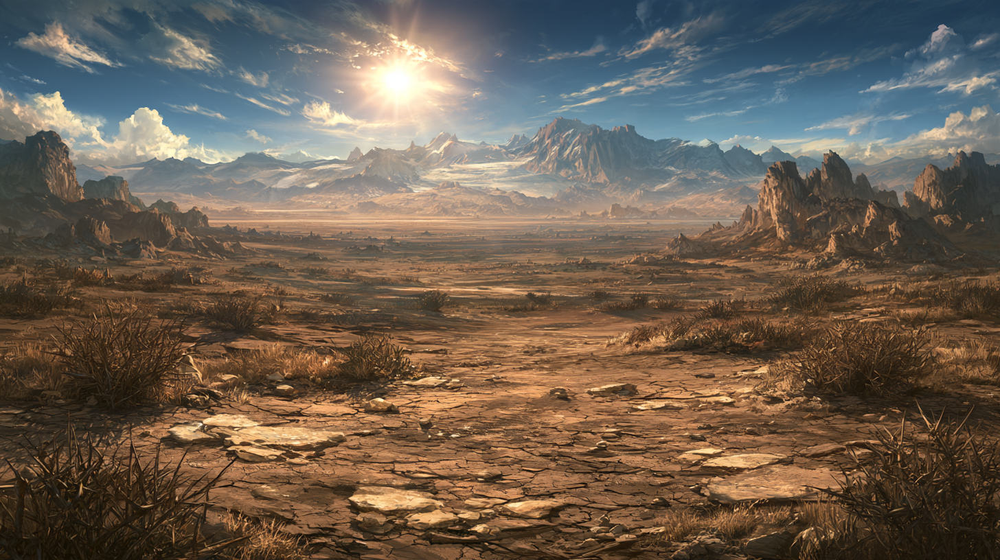

<!-- tags: Landschaft, Wüste, Aridess -->
# Wüste Frilach

<!-- display: figure -->

Die Wüste Frilach umfasst einen großen Teil des Planeten Aridess und erstreckt sich von den nördlichen Polgebirgen bis zu den südlichen Klüften.In ihren nördlichen Ebenen, im Schatten des [Zirkelgebirges](/content/Himmelskörper/Aridess/Kontinent/Unol/Zirkelgebirge/index.md), lebt der traditionelle Wüstenstamm der [Kriolen](/content/Volk/Varnops/Familie/Kriolen/index.md).
