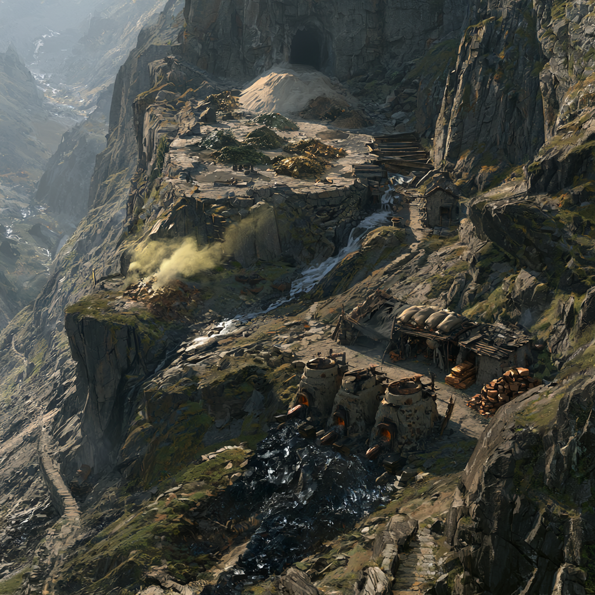

<!-- tags: Bergbau, Krolpin, Aridess -->
# Drakar-Mine

Die Drakar-Mine liegt im mittleren [Zirkelgebirge](/content/Himmelskörper/Aridess/Kontinent/Unol/Zirkelgebirge/index.md), an der Route zwischen der [Kharrak-Mine](/content/Himmelskörper/Aridess/Kontinent/Unol/Zirkelgebirge/Kharrak-Mine/index.md) am Gebirgsrand und dem Zirkel-Tal.
In ihr wird hauptsächlich Kupfer abgebaut und zu Bronze, später auch zu Messing, verarbeitet.
Das Zinn für die Bronze bezieht die Mine aus den [Murgath-Stollen](/content/Himmelskörper/Aridess/Kontinent/Unol/Zirkelgebirge/Murgath-Stollen/index.md).
Die Leitung der Mine obliegt [Torval](/content/Volk/Varnops/Familie/Krolpin/Charakter/Torval-Krolpin/index.md).

## Historische Bedeutung

Mit Torval geht [Hiante Krolpin](/content/Volk/Varnops/Familie/Krolpin/Charakter/Hiante-Krolpin/index.md) nach Lerold ihre zweite Beziehung mit einem Minenleiter des Zirkelgebirges ein.
Aus ihr gehen Hiantes Zwillingstöchter Jell und Liss hervor.
