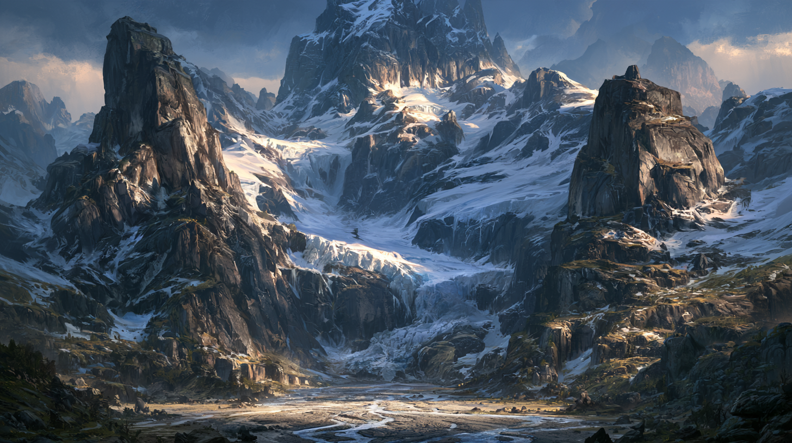

<!-- tags: inherit=1 -->
# Zunir, der Süd-Kontinent

<!-- display: figure -->

# Allgemein

Zunir ist einer der zwei Kontinente von Aridess.
Er umfasst nahezu die gesamte Südhalbkugel, von den grünen Schluchten am Äquator bis zum Senduun-Gebirge an seinem Südpol.

Wie das Zirkelgebirge im Norden entsteht auch das Senduun-Gebirge durch dieselbe äquatoriale Plattenspreizung, die Unol und Zunir auseinanderdrückt — nur an der gegenüberliegenden Polkante.

## Bevölkerung

Im Gegensatz zum Zirkelgebirge hat der Zirkel-Wettstreit die Stämme des Senduun-Gebirges nie erreicht.
Sie leben bis heute in kleinen, voneinander unabhängigen Gruppierungen und stehen keinem Zirkel nahe.
Edelsteine gelten bei ihnen weiterhin vor allem als Wertobjekte und kultische Prestigesymbole, nicht als technisches Bauteil.

## Ressourcen

Auch im Zirkelgebirge gibt es Edelsteine, etwa in den Flussbetten um die Murgath-Stollen, doch bleiben das vereinzelte Funde.
Das Senduun-Gebirge birgt dagegen ein riesiges, kaum berührtes Vorkommen besonders reiner Edelsteine.
Dieser Reichtum gilt als einer der Hauptgründe, warum der Norden trotz der schwierigen Querung der Verdialen langfristig an einer Ausdehnung nach Süden interessiert blieb.