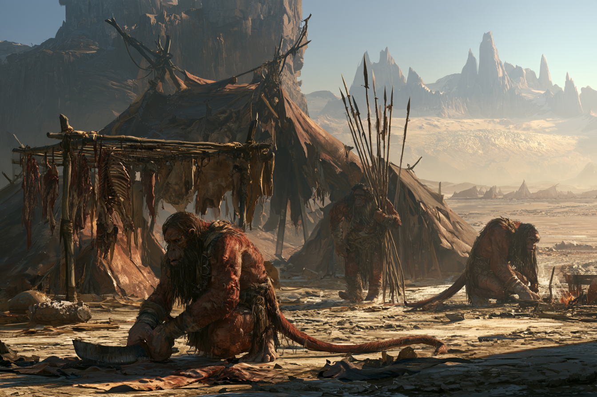

<!-- tags: inherit=1 -->
# Familie Kriolen, Wüstenstamm der nördlichen Frilach-Ebenen

<!-- display: figure -->

Die Kriolen sind ein kleiner, eigenständiger Stamm in den nördlichen Ebenen der [Wüste Frilach](/content/Himmelskörper/Aridess/Kontinent/Unol/Frilach/index.md), im Schatten des [Zirkelgebirges](/content/Himmelskörper/Aridess/Kontinent/Unol/Zirkelgebirge/index.md).
Sie leben hauptsächlich vom Jagen und Sammeln.
Mit den Bergsiedlungen im Norden unterhalten sie nur rudimentäre Handelsbeziehungen und tauschen dabei Leder und Fleisch gegen verarbeitetes Metall in Form von Waffen und Werkzeugen.

Der Stamm ist traditionell und wertschätzt altbekannte Werte und Normen.
Fremden Dingen gegenüber hegen die Kriolen keinen Groll, halten die Kontaktpunkte aber stets gering.

Aus diesem Stamm stammt [Hiante Krolpin](/content/Volk/Varnops/Familie/Krolpin/Charakter/Hiante-Krolpin/index.md), die ihn verlässt, um in den Bergen die Familie Krolpin zu gründen.
