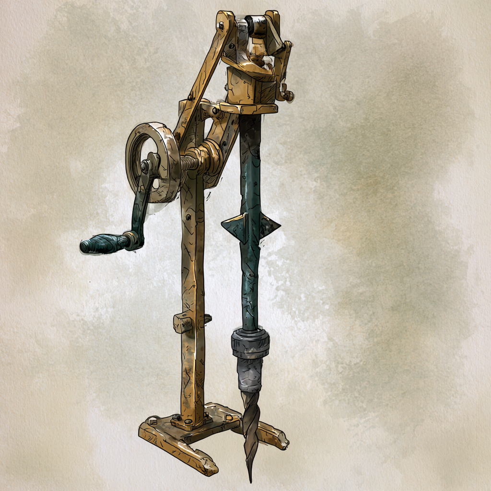

<!-- tags: Krolpin, Bergbau, Handel, inherit=1 -->
# Zirkel des Erz-Phoriats
Das Erz-Phoriat ist letztendlich der älteste und einflussreichste Zirkel der Varnops und wird angefürt von der Familie [Krolpin](Familie/Krolpin/index.md).
Noch lange bevor sich die anderen Zirkel bilden, besiedeln die Stämme des Erz-Phoriats bereits die nördlichen Gebirgsketten.
Dabei sind sie besonders bekannt für ihre effizienten Erzbohrungen und die dafür verwendeten Gerätschaften.
Über viele transitive Handelsketten stellen sie letztendlich die Hauptversorgung für Metall auf dem Planeten Aridess dar.

## Entwicklung des Phoriats
<!-- event: start=-1.23 category="Aridess" text="Erste Phoriat-Handbohrer" fuzzy -->
Die Stämme des Erz-Phoriats entwickeln bereits einige Generationen vor der Familie Krolpin den ersten Phoriat, einen Bohrer, mit dem ein Varnop effektiv in den Boden graben kann und dabei Erde und selbst Stein deutlich schneller durchdringt als mit Hammer und Meißel.
Der Phoriat ist ein Kurbel-Schlagbohrer aus Bronze: Eine Kurbel hebt über eine Nockenwelle einen schweren Fallhammer, der auf eine eiserne Bohrspitze schlägt, die sich mit jedem Schlag ein Stück weiterdreht.

Mit den Bohrern entstehen schließlich die vielen Erzminen in den nördlichen Gebirgen.
Erst Generationen später übernimmt die Familie Krolpin durch die Beziehungen von [Hiante Krolpin](/content/Volk/Varnops/Familie/Krolpin/Charakter/Hiante-Krolpin/index.md) zu den Minenleitern die Führung dieser Tradition.
Die Krolpins bauen mit der Zeit immer mehr Handelsbeziehungen auf, da die geschürften Metalle bei den Stämmen außerhalb der Gebirge heiß begehrt sind und nehmen so eine immer mächtiger werdende Position im Zirkelgebirge ein.
Doch sind die Handelswege insgesamt recht ineffizient und die Krolpins verzeichnen häufig unvorhersehbare Verluste.
Außerdem sind die ersten Bohrer mühsam angefertigte Einzelstücke, welche nur wenige herzustellen in der Lage sind.
Dies motiviert die Entscheidung der Krolpins, ihren Einfluss zu nutzen um einen technischen Aufschwung in Form einer Globalisierung anzustoßen.
Dafür rufen sie den [Zirkel-Wettstreit] aus und nehmen auch selbst als Gruppe an ebendiesem teil.
Ihre beitragende Erfindung ist natürlich der Phoriat mit dem sie bereits so viele Minen angelegt haben.
Während diese Bohrer zu Beginn noch vergleichsweise klein sind und von einem einzigen Varnop bedient werden, entwickeln sie sich durch den Wettstreit schließlich zu riesigen Gerätschaften, welche von innen gesteuert werden und breite Tunnel graben können.
Dies erhöht nicht nur die Effektivität der vielen Erzbohrungen im Zirkelgebirge, sondern lässt mit der Zeit auch riesige Tunnelsysteme entstehen in welchen sich die Städte des Erz-Phoriats und die Hauptsitze der Zirkel entwickeln konnten.